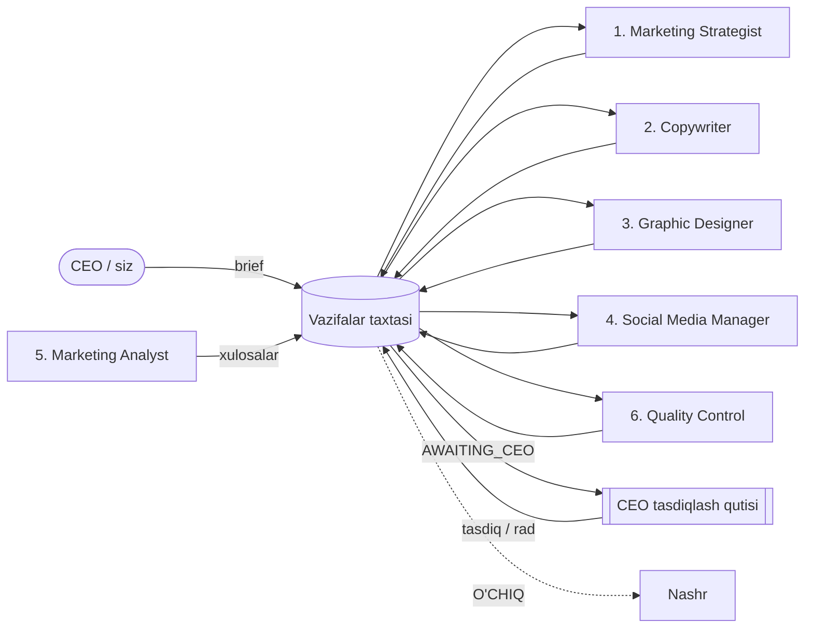

# AI OFFICE — Arxitektura

## Umumiy sxema

Agentlar bir-biri bilan **hech qachon** to'g'ridan-to'g'ri gaplashmaydi. Har bir agent taxtaning faqat **o'ziga tegishli ko'rinishini** (`BoardView`) oladi.

## Holatlar

| Holat | Kim qo'yadi | Ma'nosi |
|---|---|---|
| `NEW` | CEO | Yangi brief |
| `STRATEGY_READY` | Marketing Strategist | Strategiya tayyor |
| `COPY_READY` | Copywriter | Matnlar tayyor (yoki qayta ishlangan) |
| `DESIGN_READY` | Graphic Designer | Dizayn tayyor |
| `PACKAGE_READY` | Social Media Manager | Instagram paketi tayyor |
| `QC_PASSED` | Quality Control | Tekshiruvdan o'tdi |
| `QC_REJECTED` | Quality Control | Qaytarildi (Copywriter 2 martagacha qayta ishlaydi) |
| `AWAITING_CEO` | Quality Control | Sizning qutingizda |
| `CEO_APPROVED` | **Faqat CEO** | Tasdiqlandi (nashr qilinmaydi) |
| `CEO_REJECTED` | **Faqat CEO** | Rad etildi |
| `PUBLISHED` | **Hech kim** | Hozircha yetib bo'lmaydi |

## Bo'limlar va egalari

| Bo'lim | Egasi |
|---|---|
| `strategy` | Marketing Strategist |
| `copy` | Copywriter |
| `design` | Graphic Designer |
| `instagram` | Social Media Manager |
| `qc` | Quality Control |
| `ceoDecision` | CEO |
| insights | Marketing Analyst |

## Himoya qatlamlari

1. **Ruxsatlar jadvali** (`src/core/permissions.ts`): ruxsat etilgan har bir o'tish aniq yozilgan.
2. **Shaxsga bog'langan ko'rinish:** agent boshqa birovning nomidan ish qila olmaydi.
3. **Shartlar:** bosqich ishi bajarilmaguncha vazifa keyingi bosqichga o'tmaydi.
4. **Qulf:** Sifat nazoratidan o'tgan kontentni hech kim o'zgartira olmaydi.
5. **Nusxalar:** agentlar vazifalarning nusxasini oladi, asl ma'lumotni o'zgartira olmaydi.
6. **Nashr o'chiq:** ikki shart birga kerak bo'ladi: CEO tasdig'i + `PUBLISHING_ENABLED=true`. Bu versiyada esa nashr umuman yo'q.
7. **Testlar:** xavfsizlik va arxitektura testlari har bir PR'da CI orqali ishlaydi.
